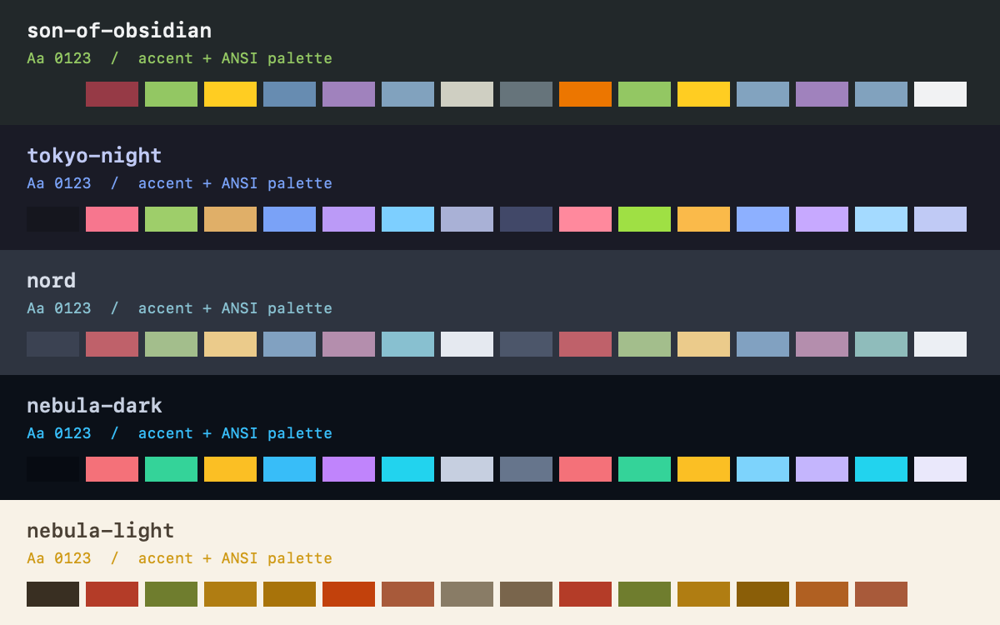

# Herdr Themes

Palette-only themes for the native [Herdr app](https://herdr.dev).
Includes the five initial palettes below and **143 additional palettes**
covering every variant of the [top 20 VS Code Themes listings by installs](https://vscodethemes.com/?sort=installs),
captured November 10, 2026.

The expansion contains **123 licensed ports** and **20 independently designed
originals** in place of Material Theme and Monokai Pro, whose current packages
do not permit redistribution. The originals are not copies, small color
perturbations, official variants, or intended visual matches.
See the [ranked collection](catalog/README.md) for all 20 listings and files.

| Theme | Appearance | Style |
| --- | --- | --- |
| `son-of-obsidian` | Dark | Charcoal, green, orange and gold |
| `tokyo-night` | Dark | Original Tokyo Night, blue and violet |
| `nord` | Dark | Arctic blue-grey and muted pastels |
| `nebula-dark` | Dark | Blue-black, cyan and violet |
| `nebula-light` | Light | Warm paper, turmeric and earthy accents |

These are community ports, not official upstream distributions.
They change terminal palettes and semantic panel colors only.
No mods, scripts, fonts, key bindings or layouts are installed.
No network access or running code is required by the themes.



## Install

Ask your agent:

> Read ~/.config/herdr-app/AGENTS.md, then add the palette-only themes from
> github.com/jdylanmc/herdr-themes. Copy themes/*.json into the Herdr themes
> directory without overwriting existing files. Keep my current theme and layout.

Or copy the desired JSON files from `themes/` to
`~/.config/herdr-app/themes/`. Herdr discovers them live.
Choose a palette in the theme picker when ready.

For automatic Nebula appearance switching, set your layout root's `theme`:

```json
{ "theme": { "light": "nebula-light", "dark": "nebula-dark" } }
```

Settings can provide the same mapping where the layout does not set a theme.
Installing files alone does not activate them.
Remove the added files to uninstall, after selecting another theme.

## Palette adaptations

Son of Obsidian maps editor syntax colors to the terminal's 16 ANSI slots;
its original editor theme does not define an ANSI palette.
Tokyo Night preserves the upstream Night terminal palette.
Nord uses its canonical colors, with Nord 2 for readable selection highlighting.
Nebula maps Obsidian surfaces, text, syntax and callout colors to Herdr tokens
and ANSI slots. Its warm light palette intentionally uses earthy hues rather
than inventing blue and cyan colors absent from the source.
Nebula's translucent selections and hover fills are composited onto its
primary background to produce opaque Herdr colors.
These ports do not change fonts or add syntax highlighting to terminal programs.

## Sources and licenses

| Theme | Source revision | License |
| --- | --- | --- |
| Son of Obsidian | [Rob Prouse's VS Code port](https://github.com/rprouse/theme-obsidian/blob/d76b1c3c16435ecc4d4bd5cab2e9430a3aa23a53/themes/son-of-obsidian-color-theme.json) | MIT |
| Tokyo Night | [folke/tokyonight.nvim Night](https://github.com/folke/tokyonight.nvim/blob/cdc07ac78467a233fd62c493de29a17e0cf2b2b6/extras/ghostty/tokyonight_night) | Apache-2.0 |
| Nord | [nordtheme/nord](https://github.com/nordtheme/nord/blob/1cef71605416a222e57225b544540ce0fcec18d4/src/nord.css) | MIT |
| Nebula | [Devaang Mandalia's Obsidian theme](https://github.com/devmandalia/Nebula/blob/8f28486f4b1bd60cdd7e5b82002df8cc2c0b5480/theme.css) | MIT |

Upstream license texts are preserved in `licenses/`.
The VS Code expansion records per-file licenses in `catalog/vscode-top-20.json`.
Its MIT notices are under `licenses/vscode/`; the Bearded Theme ports remain
GPL-3.0-only, with their original JSON inputs and complete corresponding
upstream source archive under `sources/`. Do not relicense those files as MIT.
Each GPL palette has an adjacent `.json.license` modification notice.
Tokyo Night's JSON file is a modified format conversion of its upstream
terminal palette with additional Herdr panel and status color mappings.
The other initial palettes are adaptations with the mappings described above.
Independently authored designs are identified by `kind` in the expansion catalog.

## Validate

Node.js 22+ and Python 3 are sufficient; no dependencies need to be installed.
Run `npm test` and `npm run check`.
Run `npm run generate` to rebuild the expansion offline from frozen source
files and independent HSL design profiles.

The converter follows relative theme includes and child overrides. It maps
explicit terminal colors first, then editor/panel colors to Herdr tokens.
Missing ANSI entries use relevant syntax colors where available and a standard
dark/light terminal palette otherwise. Every inferred token is recorded in
the catalog; these mappings are not claims of upstream-defined terminal colors.
Translucent colors are composited onto the destination background.
Italic-only variants remain separately named even where the resulting colors
are identical. Editor effects, fonts, syntax rules and extension code are not
installed or executed.
