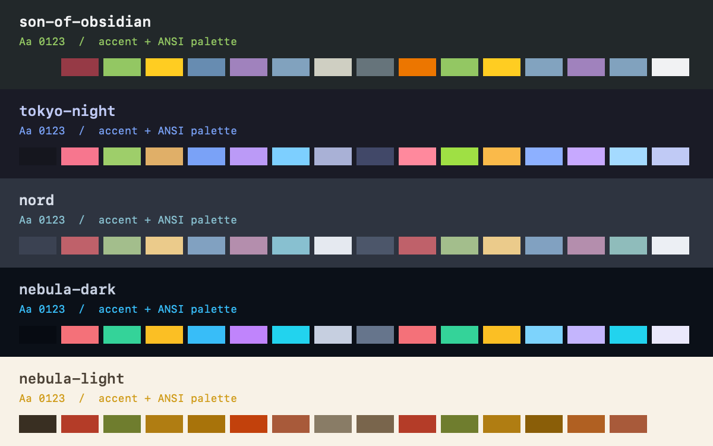

# Herdr Themes

Palette-only themes for the native Herdr app: Son of Obsidian, original
Tokyo Night, Nord, Nebula in dark and light appearances, and the 141-palette
VS Code top-20 expansion documented in catalog/README.md.

## What you see

Existing windows, panel placement, fonts and pane sizes stay as they are.
Each JSON file supplies terminal background, foreground, cursor, selection
and 16 ANSI colors, plus named panel, accent and agent-status colors.
The preview shows each palette's text, accent and ANSI swatches, not a
replacement layout.

Son of Obsidian uses charcoal `#22282a`, green `#93c763` and gold `#ffcd22`.
Tokyo Night uses `#1a1b26`, blue `#7aa2f7` and violet `#bb9af7`.
Nord uses `#2e3440`, frost `#88c0d0` and its canonical pastel colors.
Nebula Dark uses `#0b1018`, cyan `#38bdf8` and violet `#c084fc`.
Nebula Light uses paper `#f8f2e7`, turmeric `#cf9a16` and brown `#4b4135`.

## How it behaves

Installing files adds choices without activating any of them.
The theme picker changes appearance when the user selects a palette.
There are no new controls, key bindings, animations or background processes.
Existing mods follow the theme when they use Herdr's semantic tokens.
The files map working, blocked, done, idle and unknown status colors.
Nebula can follow system appearance with
`{"theme":{"light":"nebula-light","dark":"nebula-dark"}}` on a layout root.

## Built from

Copy the requested files in `themes/` to the Herdr home's `themes/`
directory, using exclusive creation: do not overwrite existing names.
There are no `mods/` or `layouts/` folders to install.
Use the source revisions and license notices in README.md and `licenses/`
when rebuilding the ports. Son of Obsidian and Nebula require explicit
syntax-to-ANSI mappings; these are adaptations, not upstream terminal exports.

## Watch out

Do not install these into the separate Herdr terminal-interface product.
Do not replace settings, layouts, fonts or keys.
Panel colors are explicit overrides; terminal applications still own their
syntax highlighting and may override terminal colors themselves.
Copying Obsidian's CSS or remote font import does not work in Herdr and
is unnecessary.

## Done when

`npm test` and `npm run check` pass. Herdr's `themes()` API discovers every
installed name with its expected appearance, and installation leaves the
selected theme and existing layout files unchanged.
